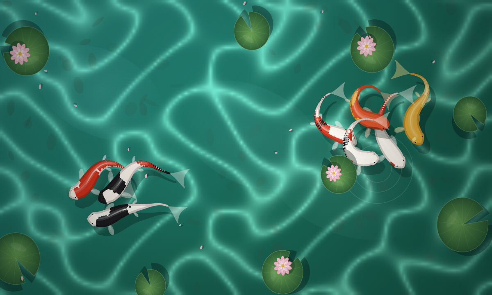
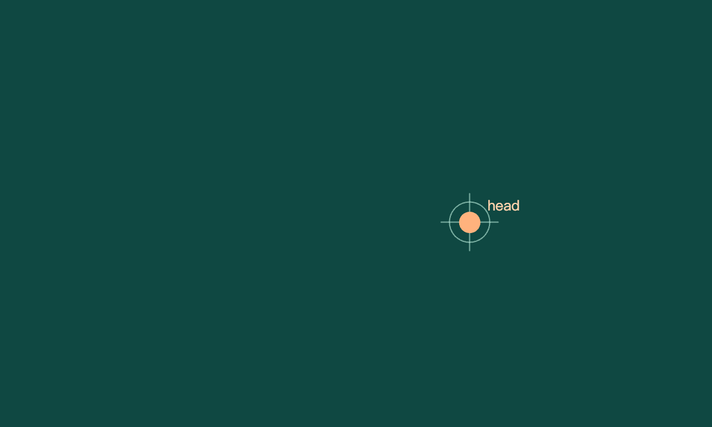
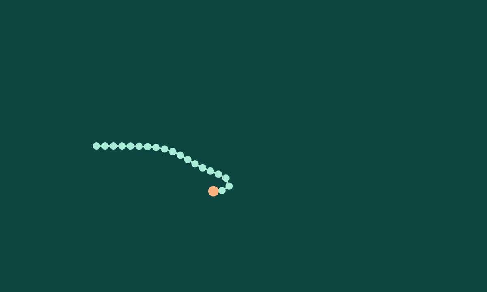
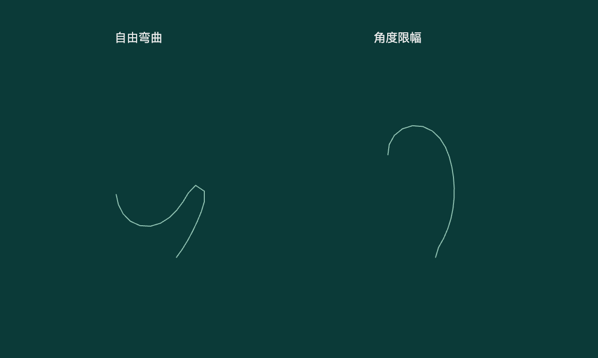
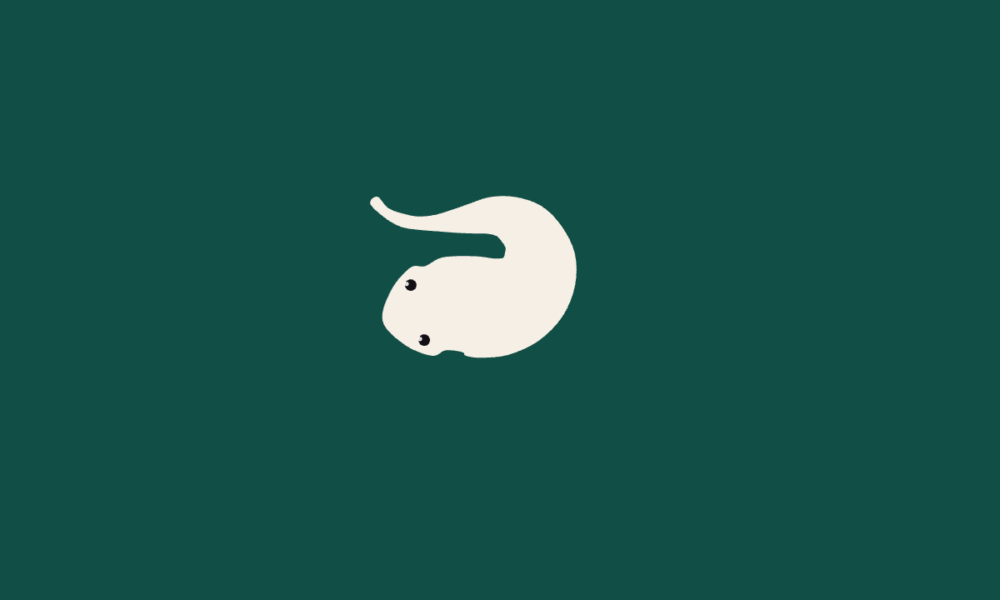
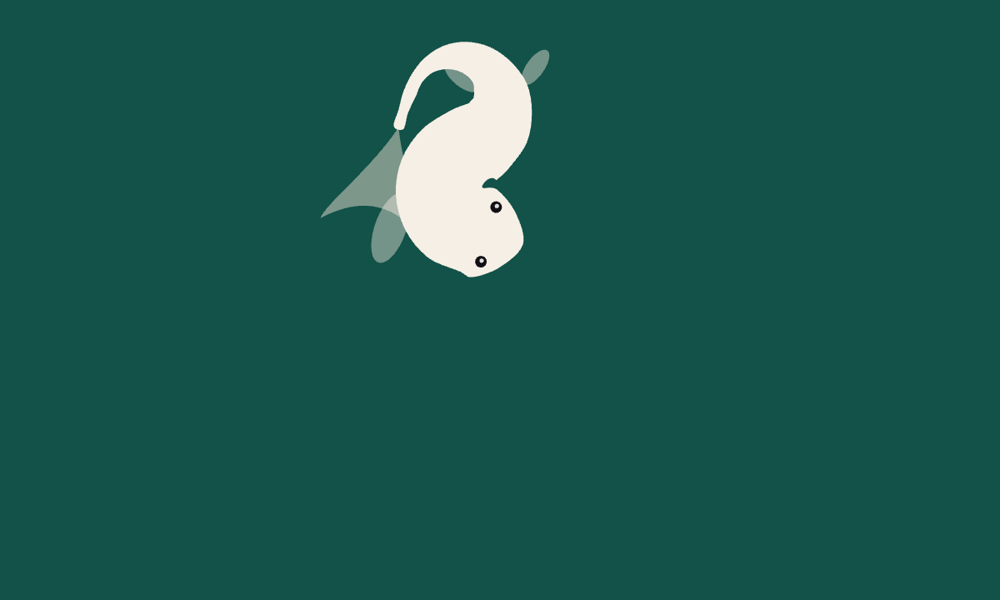
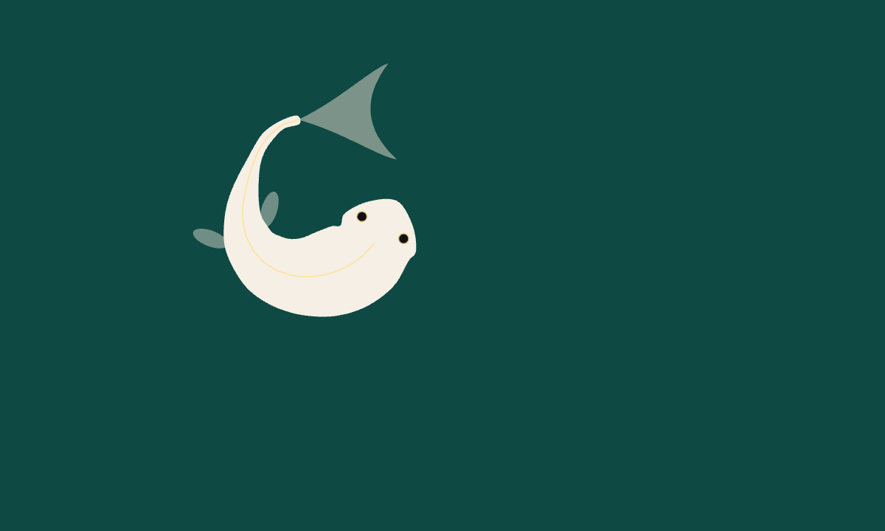
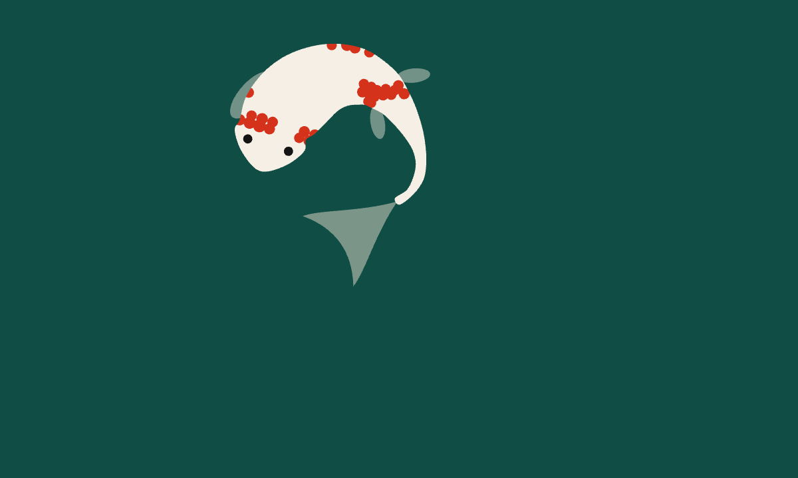

# p5.js 锦鲤游动分步教程

这是把 2026 年 10 月 3 日“小菜与老鸟”锦鲤游动教程整理成的 p5.js 版本。项目从一个会追随目标的点开始，逐步加上脊柱、弯曲限制、身体轮廓、鳍、尾巴、行波、身体坐标花纹，最后组成八条锦鲤的池塘。

在线演示：<https://xiaocai-laoniao.github.io/p5js-koi-pond/>



## 运行方式

不需要安装 npm 包。p5.js 2.3.4 已经放在 `vendor/` 目录里。

```bash
node scripts/serve.mjs
```

然后打开 <http://127.0.0.1:4173/>。

也可以直接双击 `index.html` 离线浏览。每个 `steps/*.js` 都是完整的 p5.js global-mode sketch，可以单独复制到 <https://editor.p5js.org/> 运行。

重现截图：

```bash
node scripts/capture.mjs
```

脚本会启动本地静态服务器，用 Chrome/Chromium 打开每个步骤页面，模拟 12 秒后输出 1200x720 PNG 到 `assets/screenshots/`，并写入 `qa/browser-report.json`。如果 Chrome 不在默认位置，可以设置：

```bash
CHROME_PATH="/path/to/chrome" node scripts/capture.mjs
```

## 步骤目录

| 步骤                    | 运行                                     | 源码                                 | 截图                                                |
| ----------------------- | ---------------------------------------- | ------------------------------------ | --------------------------------------------------- |
| 01 让头部追随平滑目标   | [HTML](steps/01-smooth-target.html)      | [JS](steps/01-smooth-target.js)      | [PNG](assets/screenshots/01-smooth-target.png)      |
| 02 固定节距的脊柱链     | [HTML](steps/02-fixed-spine.html)        | [JS](steps/02-fixed-spine.js)        | [PNG](assets/screenshots/02-fixed-spine.png)        |
| 03 用角度限幅控制弯曲   | [HTML](steps/03-bend-limit.html)         | [JS](steps/03-bend-limit.js)         | [PNG](assets/screenshots/03-bend-limit.png)         |
| 04 沿法线长出身体和眼睛 | [HTML](steps/04-body-outline.html)       | [JS](steps/04-body-outline.js)       | [PNG](assets/screenshots/04-body-outline.png)       |
| 05 鳍和尾巴慢半拍跟随   | [HTML](steps/05-fins-tail.html)          | [JS](steps/05-fins-tail.js)          | [PNG](assets/screenshots/05-fins-tail.png)          |
| 06 行波推进和固定步长   | [HTML](steps/06-wave-dt.html)            | [JS](steps/06-wave-dt.js)            | [PNG](assets/screenshots/06-wave-dt.png)            |
| 07 用身体坐标生成花纹   | [HTML](steps/07-pattern-body-space.html) | [JS](steps/07-pattern-body-space.js) | [PNG](assets/screenshots/07-pattern-body-space.png) |
| 08 八条锦鲤组成一池鱼   | [HTML](steps/08-school-pond.html)        | [JS](steps/08-school-pond.js)        | [PNG](assets/screenshots/08-school-pond.png)        |

## 01. 让头部追随平滑目标



先把锦鲤缩成一个头部点。目标由 `noise()` 生成，所以它不会随机跳动，而是在池子里缓慢漂移。鱼头每一帧先算出指向目标的期望速度，再用 `vel.lerp(desired, 0.045)` 慢慢靠近这个速度。

这一节的重点不是画鱼，而是让“游动意图”变得连续。后面的整条鱼都会跟着这个头部点走，如果头部方向忽快忽慢，身体再精细也会显得僵。

可以实验：把 `0.045` 改成 `0.12`。数值越大，头部越快贴近目标，轨迹会更急；数值越小，转向会更慢。

## 02. 固定节距的脊柱链



第二步把一个点扩展成二十个关节。第一个关节是头部，后面的关节只追前一个关节，并保持固定距离。这样就能得到一条不会被拉长的身体中线。

`constrainDistance(pointValue, anchor, segment)` 是核心：它从锚点指向当前点，重新放回距离锚点正好 `segment` 的位置。这个“固定节距”后面会一直保留，花纹、鳍和尾巴都依附在这条中线上。

可以实验：把 `segment` 从 `10.5` 改成 `16`。身体会变长，弯曲颗粒感也会变粗。

## 03. 用角度限幅控制弯曲



只有固定距离还不够。头部急转时，如果每一节只追前一节，链条可能绕出很尖的角。第三步加入 `maxBend`，限制相邻两节之间的角度变化。

`wrapAngle()` 用 `atan2(sin(a), cos(a))` 把角度差压回 `-PI` 到 `PI`，再用 `constrain()` 限制弯曲。画面里左右两条链做了对照：自由弯曲更容易折，角度限幅更像鱼身。

可以实验：把 `maxBend` 从 `0.38` 改成 `0.18`。数值越小，身体越硬；数值越大，身体越柔软。

## 04. 沿法线长出身体和眼睛



第四步让中线长出身体。每个关节有一个半宽，沿局部法线向左右取点，左右两排点合起来就是鱼身轮廓。头部前方再补一段圆弧，让眼睛留在圆润的吻部内。这里开始使用浏览器的 `Path2D` 和 p5 的 `drawingContext`，方便用平滑曲线填充身体。

这一版还保留了一个稳定性修复：前进距离使用 `Math.min(108 * dt, distanceValue)`，保证鱼头最多只走到目标，不会越过目标后反复掉头。朝向本身也用角度平滑更新，目标改变时鱼身会自然转过去。

可以实验：把 `widths` 的第一个 `26` 改成 `36`。头部会更宽，整条鱼的比例也会改变。

## 05. 鳍和尾巴慢半拍跟随



第五步保留上一节的眼睛，再加上胸鳍、腹鳍和尾鳍。鳍片的位置来自身体边缘，方向来自对应关节的朝向。转弯时，外侧胸鳍会稍微张开，让画面多一点姿态变化。

鱼头继续追随画布内的平滑目标，并限制每次移动距离，避免演示几秒后离开画面。

尾鳍使用一级平滑：`tailAngle` 每帧只追上尾部目标角度的一部分。它不是严格的物理弹簧，只是用很小的代码做出“慢半拍”的柔软感。

可以实验：把 `tailFollowRate` 从 `7.2` 改成 `16.8`。数值越大，尾鳍越紧地跟随身体；数值越小，尾巴越拖。

## 06. 行波推进和固定步长



第六步加入行波。这里有一个重要边界：脊柱约束负责真实运动，行波只改变本帧绘制出来的位置。也就是说，鱼的平移仍然来自速度和朝向规则，摆动只是显示层的法线偏移。

这一节还把速度、相位和转向都绑定到固定步长 `dt` 上。不同设备帧率不一样，但模拟会尽量保持相近速度。

可以实验：把 `maxSpeed` 从 `175` 改成 `90`。鱼会游得更稳，尾部摆动频率和幅度都会变小。

## 07. 用身体坐标生成花纹



如果直接用屏幕坐标画斑块，鱼游动时花纹会像贴在玻璃上。第七步把花纹放进身体坐标：`s` 表示沿脊柱的位置，`u` 表示从中线向左或向右的比例。

花纹点只在开始时缓存一次，每帧再用当前身体姿态转换成画布坐标。绘制时用 `drawingContext.clip(bodyPath)` 裁剪，所以斑块不会溢出鱼身。

可以实验：把 `patternThreshold` 从 `0.56` 改成 `0.64`。阈值越高，斑块越少。

## 08. 八条锦鲤组成一池鱼


最后一步把单鱼复制成八条，并加入鱼群规则。分离让鱼不会挤在一起，对齐让游向逐渐协调，聚合让鱼群保持松散聚集，边界回避让鱼靠近池边时转回画面内部。

池塘背景也在这一节完成：水色、波光、荷叶、花瓣、阴影和不同花色都放在同一个 p5 草图里。鱼身的行波依然只用于本帧绘制点，不破坏脊柱约束。

可以实验：把 `separationDistance` 从 `140` 改成 `180`。鱼群间距会变大，整体会更分散。

## 文件结构

```text
.
├── index.html
├── README.md
├── steps.json
├── steps/
│   ├── 01-smooth-target.html
│   ├── 01-smooth-target.js
│   └── ...
├── assets/screenshots/
├── scripts/
│   ├── capture.mjs
│   └── serve.mjs
└── vendor/
    ├── p5-2.3.4.min.js
    └── p5-LICENSE.txt
```

## 验证与截图

8 张截图均来自对应步骤的实际运行：固定随机种子，推进 12 秒模拟时间，输出 1200 × 720 PNG。

浏览器检查结果见 [qa/browser-report.json](qa/browser-report.json)：

- 8 个步骤可独立运行，画面持续变化，30 / 60 fps 在相同模拟时刻的状态一致。
- 第 4 步模拟 60 秒，越过目标次数为 0，最大单帧转角约 6.18°。
- 最终鱼池连续运行 30 秒，无运行时错误。
- 8 步切换、暂停、继续、重新开始通过；390px 手机布局无横向溢出，减弱动态偏好会默认暂停。

已使用 Chrome 检查，其他浏览器尚未单独验收。截图脚本会重新执行这些检查并更新报告。

这里的行波是程序化视觉变形，群游规则是创作模型；它们用于学习动画，并非鱼类生物力学模拟。

## p5.js 参考

- [setup 与 draw](https://p5js.org/tutorials/setting-up-your-environment/)
- [drawingContext](https://p5js.org/reference/p5/drawingContext/)：访问 Canvas 2D 的路径、裁剪与渐变。
- [deltaTime](https://p5js.org/reference/p5/deltaTime/)：帧间隔，供累计固定模拟时间使用。
- p5.js 2.3.4 的 LGPL-2.1 许可与上游链接见 [vendor/README.md](vendor/README.md)。
